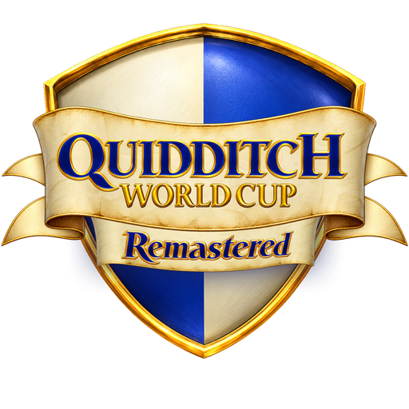
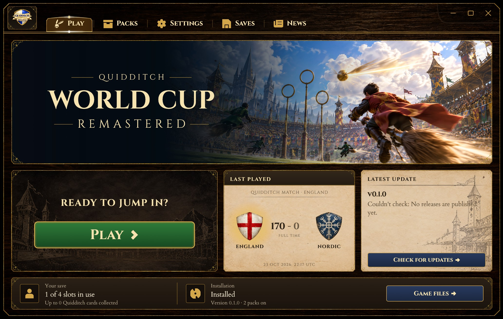

<p align="center">
  
</p>

<h1 align="center">Quidditch World Cup Remastered</h1>

<p align="center">
  A modder-friendly rebuild of <i>Harry Potter: Quidditch World Cup</i> (EA, 2003) for today's PCs:<br>
  the original game decompiled, translated to Rust, and opened up for modding.
</p>

> [!WARNING]
> **This project is VERY much a work in progress.** Expect missing features, bugs, crashes and big changes
> between versions. Save files and packs made today may not work with later releases.
>
> **Resource packs (the remastered textures, models, movies and layouts) are not publicly available yet.** The
> releases contain the engine, the launcher and the modding tools only. Out of the box the game plays as the
> original, drawn from your own copy of it.

> [!IMPORTANT]
> **You need your own copy of the game.** This repository and its releases contain **no** game files: no models,
> textures, sounds, movies, text or executable from the original. You provide your own installation of the PC
> version, and your own no-CD (unwrapped) `QWC.exe`, because the remaster cannot read the copy-protected retail
> one. We don't distribute copyrighted files and won't link to them, so please don't ask.



## What this is

Quidditch World Cup never got a modern release, and its file formats were never documented. This project works
through the original PC game, its data files and its program code, to find out exactly how everything works,
then rebuilds it in modern code: a decompilation of the game, translated to [Rust](https://www.rust-lang.org/).

The aim is faithful first. The new engine loads the original files from your copy of the game and plays the way the
original did: the same rules, the same AI, the same menus. On top of that it is built to be modded: every texture,
model, animation, movie, font, menu layout, HUD element, shader and gameplay setting can be replaced or tuned by a
**resource pack**, without touching the original files.

### It's a modding tool

The remaster is, in essence, a modding tool. It ships no game content of its own: it is an engine that runs the
game you already own, a launcher that manages it, and the tools to make packs for it. Everything you see in a match
comes from your copy of the game, or from packs you choose to install.

## What's in it

- **The launcher**
  - sets up and checks your game files, and imports them into its library;
  - manages resource packs (turn them on and off, set their order, install `.qwcpack` files);
  - keeps backups of your saves;
  - shows your recent matches, the news and updates;
  - **online play**: one player hosts, the other joins by address. There are no servers: the two games talk
    directly, and the launcher helps with routers (UPnP, NAT hole punching, a connection check).
- **The game**
  - the original's matches, House Cup, World Cup and challenges;
  - remastered lighting with shadows, fog and colour grading per stadium;
  - vector fonts and wide-screen menus;
  - gamepads.
- **QWC Studio**, the pack editor
  - exports the game's textures and models for editing;
  - imports players and props from glTF onto the original skeleton, with their facial morphs, and checks them;
  - edits gameplay tuning, WGSL shaders, screen layouts and the HUD, with checks as you type;
  - builds `.qwcpack` files to share.

Guides on how to mod the game with these tools are coming.

## Installing

Download the latest release from the [Releases page](https://github.com/mathancy/QuidditchWorldCupRemastered/releases).

- **Windows:** run `QWCRemastered-<version>-setup.exe`. It installs for your user only (no administrator needed)
  and offers a desktop shortcut and Start menu entries.
- **Linux:** run the `.AppImage`, or unpack the `.tar.gz` and run `qwc-launcher`.

On first start the launcher asks for your game folder and your no-CD exe, checks them and imports what it needs.
Your library (the imported game, packs, settings and save backups) lives in your user profile
(`%APPDATA%\QWCRemastered` on Windows, `~/.local/share/qwc-remastered` on Linux) and is kept when you update or
uninstall. The launcher checks this repository's releases for updates.

You need a graphics card with Vulkan, Direct3D 12 or Metal.

## Building from source

You need:

| What | For |
|---|---|
| [Rust](https://rustup.rs) (stable) | everything |
| A C compiler (Windows: Visual Studio or its Build Tools with "Desktop development with C++"; Linux: `gcc`) | OpenH264, built from source for the movies |
| [NASM](https://www.nasm.us) 2.16 (optional, recommended) | OpenH264's fast assembly; without it movies decode at about half speed |
| Linux only: `libasound2-dev`, `libudev-dev` | sound and gamepads |

Then:

```sh
cargo build --release -p qwc-launcher -p qwc-game -p qwc-studio
```

or run `launcher.cmd` (Windows) / `launcher.sh` (Linux), which build and open the launcher. `studio.cmd` /
`studio.sh` open QWC Studio. `cargo test` runs the tests, none of which need the game's files.

The installer is made by the release workflow (`.github/workflows/release.yml`) with
[Inno Setup](https://jrsoftware.org/isinfo.php) (`packaging/windows`), and the Linux AppImage with
`packaging/linux/build.sh`.

## Repository layout

| Folder | What's in it |
|---|---|
| `crates/qwc-formats`, `qwc-assets` | Reading and loading the game's files |
| `crates/qwc-render`, `qwc-anim`, `qwc-audio`, `qwc-video`, `qwc-text` | Graphics, animation, sound, movies and text |
| `crates/qwc-sim` | The gameplay: the rules, the AI, the Snitch |
| `crates/qwc-feck` | The original's menu script machine |
| `crates/qwc-frontend`, `qwc-hud` | The menus and the HUD |
| `crates/qwc-net` | Online play (peer to peer, lockstep) |
| `crates/qwc-packs`, `qwc-settings` | Resource packs and the player's settings |
| `crates/qwc-game` | The game itself |
| `crates/qwc-launcher`, `qwc-studio`, `qwc-style` | The launcher, QWC Studio and their shared look |
| `crates/qwc-dump` | A tool that dumps any of the game's files as JSON |
| `remastered/fonts` | The vector fonts the remaster ships |
| `packaging` | The installer, the AppImage and the release notes |

## Licensing

- **The code** in this repository is licensed under the [GNU General Public License v3.0 or later](LICENSE).
- **The fonts** in `remastered/fonts/` (Germania One, Cardo, Cinzel, Noto Sans) are under the
  [SIL Open Font License 1.1](https://openfontlicense.org); each font's licence is next to it.
- **The launcher's artwork and the logo** were made for this project; none of it comes from the original game.
- **Third-party Rust crates** keep their own licences (MIT, Apache-2.0, BSD, MPL-2.0 and others). Each release
  includes `THIRD-PARTY-LICENSES.html` listing every one.
- **The original game** is not covered by any of this. It, and its assets, belong to their owners and are not
  part of this repository or its releases.

## Dependencies

The main libraries the remaster is built on:

| Library | What for |
|---|---|
| [wgpu](https://wgpu.rs), [winit](https://github.com/rust-windowing/winit) | Graphics (Vulkan, Direct3D 12, Metal) and the window |
| [egui / eframe](https://github.com/emilk/egui) | The launcher's and the Studio's interface |
| [cpal](https://github.com/RustAudio/cpal) | Sound output |
| [OpenH264](https://github.com/cisco/openh264) (through the `openh264` crate), [Symphonia](https://github.com/pdeljanov/Symphonia) | The movies' pictures and sound |
| [swash](https://github.com/dfrg/swash) | Shaping and drawing text |
| [gilrs](https://gitlab.com/gilrs-project/gilrs) | Gamepads |
| [libm](https://github.com/rust-lang/libm) | Maths that gives the same result on every platform, so online matches stay in step |
| [serde](https://serde.rs), [RON](https://github.com/ron-rs/ron), [zip](https://github.com/zip-rs/zip2) | Settings, packs and their files |
| [ureq](https://github.com/algesten/ureq) | HTTPS for the update check |

The full list, with versions, is in the `Cargo.toml` files and `Cargo.lock`.

The remaster also talks to a few services:
- **GitHub's releases API**, for the news and update check.
- **Public STUN servers** (Google's and Cloudflare's), when you play online: one small request each, to learn your
  public address.
- **Your router (UPnP)**, when you host online: asked to forward the game's port while the game runs.

## Disclaimer

This is an unofficial fan project. It is not affiliated with, endorsed by or sponsored by Electronic Arts, Warner
Bros. Entertainment, J.K. Rowling or any of their partners. *Harry Potter*, *Quidditch* and related names are
trademarks of their respective owners. *Quidditch World Cup* is © Electronic Arts. No part of the original game is
distributed here.
